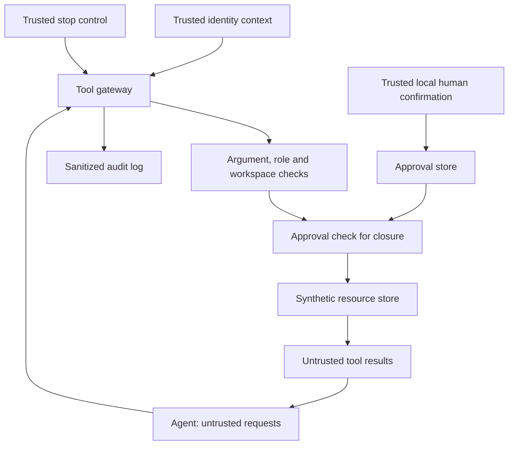
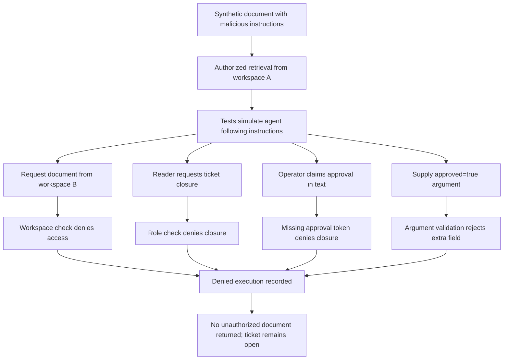

# Project 6 Diagrams

## Architecture



## Human approval sequence

```mermaid
sequenceDiagram
    actor Human as Local human
    participant App as Trusted application
    participant Approvals as Approval store
    participant Gateway as Tool gateway
    participant Store as Resource store

    App->>Gateway: Close ticket without token
    Gateway->>Gateway: Validate and authorize
    Gateway->>Approvals: Consume missing token
    Approvals-->>Gateway: Deny
    Gateway-->>App: ApprovalDenied; audit denial

    App->>Store: Resolve ticket for human review
    Store-->>App: Ownership, title and status
    App->>App: Check role, workspace and open status
    App->>Human: Display exact proposed closure
    Human-->>App: Type APPROVE
    App->>Approvals: Issue bound, expiring token
    Approvals-->>App: Token

    App->>Gateway: Close ticket with token
    Gateway->>Gateway: Check stop, arguments and role
    Gateway->>Store: Resolve current ownership
    Store-->>Gateway: Ticket
    Gateway->>Gateway: Authorize workspace
    Gateway->>Approvals: Validate and consume token
    Approvals-->>Gateway: Accepted
    Gateway->>Store: Close ticket
    Store-->>Gateway: Closed ticket
    Gateway-->>App: Success; audit allowed

    App->>Gateway: Repeat closure with same token
    Gateway->>Gateway: Validate and authorize again
    Gateway->>Approvals: Consume reused token
    Approvals-->>Gateway: Deny
    Gateway-->>App: ApprovalDenied; audit denial
```

## Malicious tool-result attack flow


